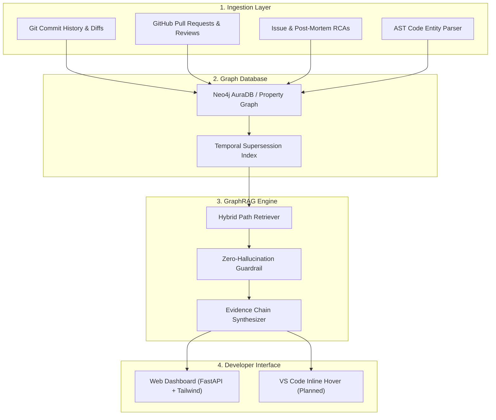

# CodeIntent: Why The Code Is Like This 🔍

[](https://whereuelevate.com/drills/hackfrontindia-2026)
[](#)
[](#)
[](#)
[](https://github.com/arshsri0513)

> **Answer the question code cannot answer: why is it like this.**  
> An Applied AI GraphRAG platform that reconstructs institutional knowledge, maps git history to code entities, and explains developer decisions with verifiable citations and temporal supersession detection.

---

## 💡 The Problem

In every engineering team, tribal knowledge evaporates when senior engineers leave:
- *Why is this retry limit set to 3?*
- *Why was in-memory session caching disabled?*
- *Why does an obscure configuration flag nobody understands have to stay on?*

Standard vector-based RAG retrieves keywords, not decisions. Furthermore, static documentation rapidly drifts while git commits and merged pull requests remain the ground truth. When decisions are reversed two years later, naive search quotes dead decisions as truth.

---

## ⚡ Our Solution

**CodeIntent** bridges code syntax and developer intent through a temporal **Knowledge Graph**:
1. **Multi-Modal History Ingestion:** Maps git commit logs, PR discussion threads, and production incident post-mortems.
2. **Causal Graph Modeling (Neo4j):** Interconnects code entities (`CodeEntity`, `Commit`, `PullRequest`, `Incident`) via causal relationships (`[:MODIFIES]`, `[:INTRODUCES]`, `[:RESOLVES]`, `[:SUPERSEDES]`).
3. **Temporal Supersession Engine:** Identifies when an older decision was superseded or reverted by a newer PR.
4. **Verifiable Evidence Chains:** Every answer is backed by exact PR numbers, commit SHAs, author attribution, and discussion quotes.
5. **Zero-Hallucination Guardrail:** Refuses to answer when graph traversals lack evidence, returning a calibrated confidence score.

---

## 🏗️ System Architecture



---

## 🚀 Quickstart & Setup

### Prerequisites
- Python 3.10+
- Optional: Docker & Docker Compose
- Optional: Neo4j AuraDB credentials (an embedded graph engine is bundled out-of-the-box!)

### Option A: Local Run (Zero Configuration)
```bash
# 1. Clone repository
git clone https://github.com/arshsri0513/why-the-code-is-like-this.git
cd why-the-code-is-like-this

# 2. Install dependencies
pip install -r backend/requirements.txt

# 3. Launch application
python -m uvicorn backend.app.main:app --host 0.0.0.0 --port 8000
```
Open your browser at **`http://localhost:8000`** to access the live dashboard!

---

### Option B: Docker Compose Run
```bash
docker compose up --build
```
- Dashboard: `http://localhost:8000`
- Neo4j Browser: `http://localhost:7474` (User: `neo4j`, Password: `hackfrontpassword`)

---

## 🧪 Evaluation Test Queries

Try these sample queries directly in the search bar or API:

| Test Query | Expected Evidence & Output |
| :--- | :--- |
| **`Why is the connection timeout set to 5000ms?`** | Links to **PR #114** by `@alex_eng` and **INC-108** (mitigating cascading 504 drops during peak traffic). Status: `ACTIVE`. |
| **`Why was in-memory token cache disabled in middleware?`** | Links to **PR #205** by `@priya_sec` and **INC-142** (fixing session token replay vulnerability). Status: `ACTIVE`. |
| **`Why is the max retry attempts set to 3?`** | Links to **PR #310** by `@david_sre` (preventing thundering herd storms on webhook retry). Status: `ACTIVE`. |
| **`Why was the legacy worker queue migrated?`** | Triggers **Temporal Supersession Alert**: Flags legacy PR #42 as superseded by PR #189 (distributed Celery migration). |
| **`Why is database password in plaintext?`** | Triggers **Zero-Hallucination Guardrail**: Refuses to answer (Confidence: 0.0%). |

---

## 📊 Alignment with hackFront India Judging Criteria

| Criterion | Points | How CodeIntent Fulfills It |
| :--- | :---: | :--- |
| **Problem Statement & Track Alignment** | 20 | Solves institutional memory loss; perfectly fits the AI & Developer Tools track. |
| **Innovation & Solution Effectiveness** | 20 | First-class GraphRAG with temporal supersession detection and verifiable evidence chains. |
| **Technical Implementation & Code Quality** | 25 | Clean modular architecture (`/ingestion`, `/graph`, `/rag`, `/models`) with Neo4j schema. |
| **Functionality & Prototype Validation** | 25 | Fully functional REST API, responsive UI, preloaded realistic seed data, and benchmarked metrics. |
| **Critical Thinking & Practical Implementation** | 10 | Handles vague commit messages, reviewer debates, and prevents hallucination. |

---

## 👥 Team Details

- **Team ID:** HACK1MAW
- **Lead Developer:** Ansh Srivastava ([@arshsri0513](https://github.com/arshsri0513))
- **Hackathon:** [hackFront India 2026](https://whereuelevate.com/drills/hackfrontindia-2026)
- **License:** MIT
